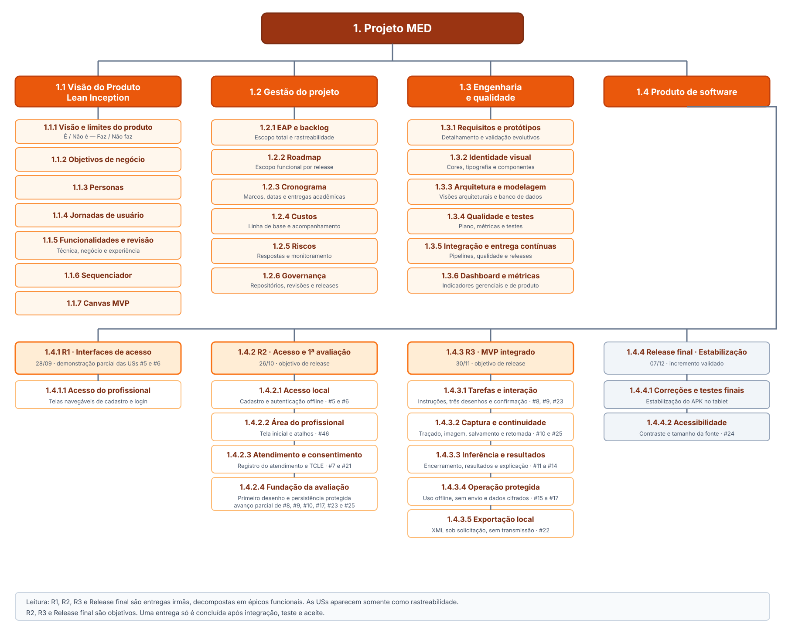

# Estrutura Analítica do Projeto

## Introdução

A Estrutura Analítica do Projeto (EAP) decompõe o escopo total do MED em
entregas verificáveis. A estrutura parte do projeto completo, destaca a Visão
do Produto como entrega principal e separa gestão, engenharia e qualidade e
produto de software. O produto é detalhado por release e por épico funcional.

A EAP segue a regra dos 100%: os componentes apresentados representam o
escopo planejado do projeto, sem incluir trabalho que não contribua para uma
entrega. As histórias de usuário não são um nível da decomposição; elas são
referenciadas apenas para permitir a rastreabilidade entre os épicos e o
backlog do aplicativo.

## Relação com o processo de desenvolvimento

- **EAP:** delimita o escopo total e organiza as entregas.
- **Sequenciador:** registra a prioridade funcional e o corte do MVP.
- **Backlog:** detalha os épicos em histórias de usuário e critérios de
  aceitação.
- **Roadmap:** distribui as entregas da EAP ao longo das releases.
- **Quadro de trabalho:** acompanha a execução e o aceite de cada história.

Esses artefatos devem ser atualizados em conjunto quando uma mudança de
escopo for aprovada. O detalhamento dos requisitos ocorre de forma evolutiva,
próximo da implementação, para reduzir retrabalho.

## Diagrama da EAP

O diagrama apresenta épicos, e não histórias individuais. Os números das
issues indicados nos épicos servem somente como ligação com o backlog. As
metas futuras não representam funcionalidades concluídas.

## Dicionário da EAP

### 1.1 Visão do Produto — Lean Inception

| Código | Entrega | Resultado esperado |
|---|---|---|
| **1.1.1** | Visão e É / Não é — Faz / Não faz | Declaração do problema, do produto, dos benefícios, dos diferenciais e dos limites da solução. |
| **1.1.2** | Objetivos de negócio | Resultados esperados para IA e escore, experiência do paciente, experiência do profissional e dados. |
| **1.1.3** | Personas | Perfis, comportamentos e necessidades do paciente e do profissional de saúde. |
| **1.1.4** | Jornadas de usuário | Etapas de aplicação da triagem para o paciente e para o profissional de saúde. |
| **1.1.5** | Funcionalidades e revisão | Funcionalidades organizadas em clusters e revisadas nas perspectivas técnica, de negócio e de experiência. |
| **1.1.6** | Sequenciador | Funcionalidades priorizadas em ondas, com dependências e separação entre MVP e incrementos subsequentes. |
| **1.1.7** | Canvas MVP | Proposta do MVP, hipóteses, métricas de validação e estimativa de custo. |

### 1.2 Gestão do projeto

| Código | Entrega | Resultado esperado |
|---|---|---|
| **1.2.1** | EAP e backlog | Escopo total decomposto em entregas e backlog estimado e rastreável. |
| **1.2.2** | Roadmap | Escopo funcional distribuído entre releases, épicos e objetivos demonstráveis. |
| **1.2.3** | Cronograma | Marcos oficiais, datas das releases e entregas acadêmicas da disciplina. |
| **1.2.4** | Custos | Linha de base de custos e acompanhamento do valor realizado por release. |
| **1.2.5** | Riscos | Riscos identificados, analisados, respondidos e monitorados durante o projeto. |
| **1.2.6** | Governança | Fluxo de branches, revisões, releases, contribuições e aceite mantido nos repositórios. |

### 1.3 Engenharia e qualidade

| Código | Entrega | Resultado esperado |
|---|---|---|
| **1.3.1** | Requisitos e protótipos | Requisitos e protótipos detalhados de forma evolutiva e validados com os POs antes da implementação. |
| **1.3.2** | Identidade visual | Padrões de cores, mensagens, tipografia, ícones, botões e demais componentes visuais. |
| **1.3.3** | Arquitetura e modelagem | Visões arquiteturais, componentes, integração com a IA e modelos conceitual e lógico do banco de dados. |
| **1.3.4** | Qualidade e testes | Modelo de qualidade, métricas, testes unitários, de integração, funcionais, de sistema e de aceitação. |
| **1.3.5** | Integração e entrega contínuas | Pipelines de verificação, coleta de métricas e geração de releases. |
| **1.3.6** | Dashboard e métricas | Indicadores gerenciais, de processo e de produto apresentados de forma rastreável. |

### 1.4 Produto de software

#### 1.4.1 R1 — Interfaces de acesso

A R1 registrou o incremento demonstrado em 28/09. A existência das telas não
representa o aceite integral das histórias de cadastro e login.

| Código | Épico | Escopo | Rastreabilidade |
|---|---|---|---|
| **1.4.1.1** | Acesso do profissional | Interfaces navegáveis de cadastro e login, com validações básicas do formulário. | Avanço parcial das USs [#5](https://github.com/fga-eps-mds/2026.2-UNB-FCTE_UNIEURO_MED-APP/issues/5) e [#6](https://github.com/fga-eps-mds/2026.2-UNB-FCTE_UNIEURO_MED-APP/issues/6). |

#### 1.4.2 R2 — Acesso local e primeira avaliação

A R2 tem como objetivo estabelecer o acesso funcional e demonstrar o início de
uma avaliação no tablet. O primeiro desenho é um avanço parcial das histórias
que abrangem as três tarefas e somente serão aceitas na R3.

| Código | Épico | Escopo | Rastreabilidade |
|---|---|---|---|
| **1.4.2.1** | Acesso local | Cadastro persistente e autenticação do profissional sem internet. | USs [#5](https://github.com/fga-eps-mds/2026.2-UNB-FCTE_UNIEURO_MED-APP/issues/5) e [#6](https://github.com/fga-eps-mds/2026.2-UNB-FCTE_UNIEURO_MED-APP/issues/6). |
| **1.4.2.2** | Área do profissional | Tela inicial após o login, com identificação do profissional e atalhos para novo exame, exportação, sincronização e configurações. | US [#46](https://github.com/fga-eps-mds/2026.2-UNB-FCTE_UNIEURO_MED-APP/issues/46). |
| **1.4.2.3** | Atendimento e consentimento | Registro do atendimento vinculado ao profissional e apresentação e registro do TCLE antes de qualquer desenho. | USs [#7](https://github.com/fga-eps-mds/2026.2-UNB-FCTE_UNIEURO_MED-APP/issues/7) e [#21](https://github.com/fga-eps-mds/2026.2-UNB-FCTE_UNIEURO_MED-APP/issues/21). |
| **1.4.2.4** | Fundação da avaliação | Primeiro desenho demonstrado localmente e início da persistência protegida. | Avanço parcial das USs [#8](https://github.com/fga-eps-mds/2026.2-UNB-FCTE_UNIEURO_MED-APP/issues/8), [#9](https://github.com/fga-eps-mds/2026.2-UNB-FCTE_UNIEURO_MED-APP/issues/9), [#10](https://github.com/fga-eps-mds/2026.2-UNB-FCTE_UNIEURO_MED-APP/issues/10), [#17](https://github.com/fga-eps-mds/2026.2-UNB-FCTE_UNIEURO_MED-APP/issues/17), [#23](https://github.com/fga-eps-mds/2026.2-UNB-FCTE_UNIEURO_MED-APP/issues/23) e [#25](https://github.com/fga-eps-mds/2026.2-UNB-FCTE_UNIEURO_MED-APP/issues/25). |

#### 1.4.3 R3 — MVP integrado

A R3 é o marco planejado para o MVP completo. Cada épico depende de
integração, testes no tablet em modo avião e aceite dos critérios pelo PO.

| Código | Épico | Escopo | Rastreabilidade |
|---|---|---|---|
| **1.4.3.1** | Tarefas e interação | Instruções e execução das três tarefas, com confirmação, correção e avanço entre desenhos. | USs [#8](https://github.com/fga-eps-mds/2026.2-UNB-FCTE_UNIEURO_MED-APP/issues/8), [#9](https://github.com/fga-eps-mds/2026.2-UNB-FCTE_UNIEURO_MED-APP/issues/9) e [#23](https://github.com/fga-eps-mds/2026.2-UNB-FCTE_UNIEURO_MED-APP/issues/23). |
| **1.4.3.2** | Captura e continuidade | Captura do traçado e da imagem confirmada, salvamento do progresso e retomada após interrupção. | USs [#10](https://github.com/fga-eps-mds/2026.2-UNB-FCTE_UNIEURO_MED-APP/issues/10) e [#25](https://github.com/fga-eps-mds/2026.2-UNB-FCTE_UNIEURO_MED-APP/issues/25). |
| **1.4.3.3** | Inferência e resultados | Encerramento sem escore para o paciente, inferência embarcada e resultados explicáveis acessíveis somente ao profissional. | USs [#11](https://github.com/fga-eps-mds/2026.2-UNB-FCTE_UNIEURO_MED-APP/issues/11), [#12](https://github.com/fga-eps-mds/2026.2-UNB-FCTE_UNIEURO_MED-APP/issues/12), [#13](https://github.com/fga-eps-mds/2026.2-UNB-FCTE_UNIEURO_MED-APP/issues/13) e [#14](https://github.com/fga-eps-mds/2026.2-UNB-FCTE_UNIEURO_MED-APP/issues/14). |
| **1.4.3.4** | Operação protegida | Fluxo integral sem internet, sem envio de dados clínicos e com dados locais cifrados. | USs [#15](https://github.com/fga-eps-mds/2026.2-UNB-FCTE_UNIEURO_MED-APP/issues/15), [#16](https://github.com/fga-eps-mds/2026.2-UNB-FCTE_UNIEURO_MED-APP/issues/16) e [#17](https://github.com/fga-eps-mds/2026.2-UNB-FCTE_UNIEURO_MED-APP/issues/17). |
| **1.4.3.5** | Exportação local | Geração de XML sob solicitação do profissional, sem transmissão automática. | US [#22](https://github.com/fga-eps-mds/2026.2-UNB-FCTE_UNIEURO_MED-APP/issues/22). |

#### 1.4.4 Release final — Estabilização

| Código | Épico | Escopo | Rastreabilidade |
|---|---|---|---|
| **1.4.4.1** | Correções e testes finais | Estabilização do incremento validado, correção de defeitos e verificação final no tablet. | Defeitos e pendências registrados durante as releases. |
| **1.4.4.2** | Acessibilidade | Configuração de contraste e tamanho da fonte, conforme a capacidade restante e sem regressão do MVP. | US [#24](https://github.com/fga-eps-mds/2026.2-UNB-FCTE_UNIEURO_MED-APP/issues/24). |

## Rastreabilidade com o sequenciador

| Elemento do sequenciador | Épico da EAP |
|---|---|
| Cadastrar e logar o profissional de saúde | 1.4.2.1 — Acesso local |
| Aceitar o TCLE | 1.4.2.3 — Atendimento e consentimento |
| Desenhar, confirmar, apagar e refazer | 1.4.3.1 — Tarefas e interação |
| Capturar coordenadas, ordem, tempo e imagem | 1.4.3.2 — Captura e continuidade |
| Salvar dados de progresso offline | 1.4.3.2 — Captura e continuidade |
| Rodar inferência do modelo embarcado | 1.4.3.3 — Inferência e resultados |
| Visualizar instrução e encerramento sem escore | 1.4.3.1 e 1.4.3.3 |
| Exportar XML com os dados pertinentes | 1.4.3.5 — Exportação local |
| Vincular avaliação ao profissional e ao paciente | 1.4.2.3 — Atendimento e consentimento |
| Configurar contraste e tamanho da fonte | 1.4.4.2 — Acessibilidade |
| Extrair características de cada figura | 1.4.3.3 — Inferência e resultados |

O sequenciador define a ordem de valor e as dependências funcionais. O
[roadmap](processo/roadmap.md) define em qual release cada épico será
demonstrado e aceito. A área inicial do profissional, representada pelo épico
1.4.2.2 e pela US #46, foi incorporada ao escopo depois da avaliação da R1 e,
por isso, não aparece no sequenciador original da Lean Inception.

## Histórico de versões

| Versão | Descrição | Autor(es) | Data | Revisor(es) | Data de revisão |
|---|---|---|---|---|---|
| 1.0 | Criação do documento de EAP. | [Lucas Mendonça Arruda](https://github.com/lucasarruda9) | 13/09/2026 | [Artur Mendonça Arruda](https://github.com/Artymend07) | 17/09/2026 |
| 1.1 | Remoção do macro "Gerenciamento do projeto" e reorganização dos pacotes de trabalho. | [Lucas Mendonça Arruda](https://github.com/lucasarruda9) | 17/09/2026 | [Artur Mendonça Arruda](https://github.com/Artymend07) | 19/09/2026 |
| 1.2 | Ajuste das seções e incorporação das métricas e do dashboard ao macro de qualidade. | [Lucas Mendonça Arruda](https://github.com/lucasarruda9) | 22/09/2026 | [Artur Mendonça Arruda](https://github.com/Artymend07) | — |
| 1.3 | Definição dos pacotes de R1, R2 e R3 com vínculo às USs do APP e ao roadmap. | [Daniel Ferreira Nunes](https://github.com/Mach1r0) | 26/09/2026 | — | — |
| 1.4 | Reestruturação da EAP por entregas, releases e épicos funcionais, com alinhamento ao sequenciador, backlog e roadmap após a R1. | [Daniel Ferreira Nunes](https://github.com/Mach1r0) | 10/10/2026 | — | — |
| 1.5 | Ajustes após revisão: elevação da Visão do Produto, separação entre roadmap e cronograma, inclusão da US #46 e correção da rastreabilidade. | [Daniel Ferreira Nunes](https://github.com/Mach1r0) | 12/10/2026 | — | — |
