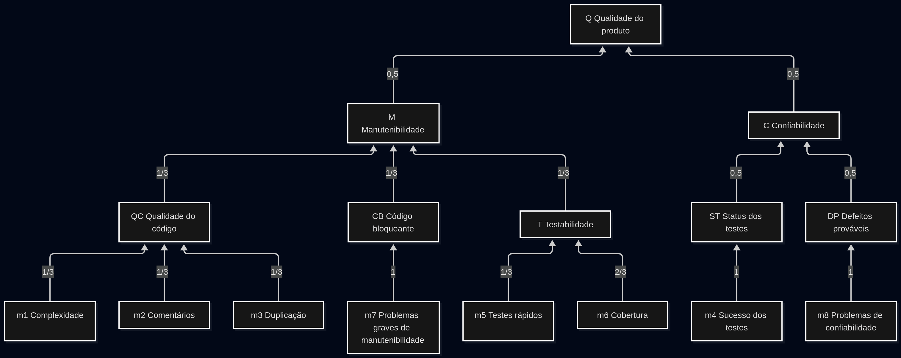

# Plano de Gerenciamento da Qualidade — MED 2026.2

## 1. Finalidade e escopo

Este plano define como a equipe avalia a qualidade do produto MED. Ele apresenta o
modelo de qualidade de referência, as métricas com suas fórmulas, os valores de
referência, a interpretação de cada resultado e os testes que produzem as evidências.

O plano cobre o aplicativo Android (MED-APP), o modelo de IA e sua exportação
(MED-IA) e a integração entre os dois, que acontece pelo arquivo do modelo empacotado
no APK, conforme o contrato da
[Arquitetura](../produto/arquitetura.md#63-contrato-entre-aplicativo-e-modelo). O
MED-DOCS não tem código de produto e fica fora das métricas de código.

### 1.1 Princípios

- Cada repositório é medido separadamente.
- Métrica ausente é registrada como "não medida", e não como zero.
- Toda medição indica repositório, branch ou tag, versão, data e fonte.
- Um quality gate aprovado mostra conformidade com a análise estática, mas não mostra
  que a história foi aceita nem que o produto se comporta como esperado. Por isso o
  plano mede separadamente a qualidade interna, do código, e a qualidade externa, do
  comportamento do produto.
- Exclusões de análise e de cobertura só mudam com justificativa técnica registrada.
- Os testes usam apenas dados fictícios. Nenhum dado sai do aparelho e nenhum escore
  aparece na tela do paciente.

## 2. Modelo de qualidade de referência

O modelo de referência é o Q-Rapids (Martínez-Fernández et al., 2018). Nele, os dados
coletados por ferramentas viram métricas normalizadas entre 0 e 1, que são agregadas
por pesos em fatores de produto e, depois, em características de qualidade.

O Q-Rapids foi escolhido por três motivos. Cada métrica tem fórmula sobre dados que o
pipeline já coleta. A agregação permite rastrear uma queda até o fator, a métrica e os
arquivos que a causaram. E fatores, pesos e limiares podem ser ajustados ao projeto.

Os nomes das características e subcaracterísticas seguem a ISO/IEC 25010:2011. O
SQALE (Letouzey; Coq, 2010), que o SonarCloud usa para calcular a dívida técnica e a nota de
manutenibilidade, entra como indicador complementar.

**Tabela 1** – Modelos de qualidade considerados

| Modelo | O que oferece | Limitação para o MED | Uso neste plano |
|---|---|---|---|
| ISO/IEC 25010 | Características e subcaracterísticas da qualidade do produto, com vocabulário padronizado | Não define métricas nem limiares | Nome das características e subcaracterísticas |
| SQALE | Dívida técnica como custo de correção das não conformidades do código, com nota de A a E | Considera só o código-fonte, sem resultados de testes nem comportamento do produto | Indicador complementar de manutenibilidade |
| Q-Rapids | Métricas normalizadas entre 0 e 1, agregadas por pesos em fatores e características | Os fatores de execução e de uso dependem de logs e monitoramento, que o MED não tem por funcionar offline | Modelo de referência |

A estrutura adotada é a seguinte. O índice Q, calculado por repositório, é um
acréscimo deste plano ao Q-Rapids.




## 3. Qualidade interna

### 3.1 Dados de entrada

As métricas são calculadas a partir do `.json` que o pipeline de release do APP e do
IA grava a cada merge, com as medidas do SonarCloud por arquivo, como descreve a
[Coleta de métricas](../metricas/coleta-de-metricas.md). Os arquivos de código são os
componentes com `qualifier` igual a `FIL`, e os de teste, os com `UTS`.

Nas fórmulas, `#X` é a quantidade de elementos do conjunto X.

- A é o conjunto dos arquivos de código com `ncloc` maior que zero.
- A_f é o subconjunto de A com pelo menos uma função.
- A_c é o subconjunto de A com cobertura medida.
- U é o conjunto dos arquivos de teste com `test_execution_time` registrado.

### 3.2 Métricas

**Tabela 2** – Métricas de qualidade interna

| Id | Métrica | Fórmula | Limiar por arquivo | Origem do limiar | Característica / subcaracterística |
|---|---|---|---|---|---|
| m1 | Densidade de arquivos não complexos | `#{a ∈ A_f : complexity(a) / functions(a) < 10} / #A_f` | Complexidade ciclomática média por função menor que 10 | McCabe (1976) | Manutenibilidade / analisabilidade e modificabilidade |
| m2 | Densidade de arquivos comentados | `#{a ∈ A : 10 < comment_lines_density(a) < 30} / #A` | Entre 10% e 30% de linhas de comentário | Faixa padrão do Q-Rapids | Manutenibilidade / analisabilidade |
| m3 | Densidade de arquivos sem duplicação | `#{a ∈ A : duplicated_lines_density(a) < 5} / #A` | Menos de 5% de linhas duplicadas | Mais tolerante que os 3% do quality gate, porque vale para o arquivo inteiro e não só para o código novo | Manutenibilidade / modificabilidade |
| m4 | Taxa de sucesso dos testes | `(tests − test_errors − test_failures) / tests` | Medida do projeto | — | Confiabilidade / maturidade |
| m5 | Densidade de arquivos de teste rápidos | `#{u ∈ U : test_execution_time(u) < 5000} / #U` | Menos de 5 s por arquivo de teste | Padrão do `slowTestThreshold` do Jest | Manutenibilidade / testabilidade |
| m6 | Densidade de arquivos com cobertura adequada | `#{a ∈ A_c : coverage(a) ≥ 75} / #A_c` | Pelo menos 75% de cobertura | Nível "louvável" da diretriz de cobertura do Google (Arguelles; Ivanković; Bender, 2020) | Manutenibilidade / testabilidade |
| m7 | Densidade de arquivos sem problema grave de manutenibilidade | `#{a ∈ A : maintainability_issue_severity(a) < alta} / #A` | Nenhum problema de manutenibilidade de severidade alta ou bloqueante | Fator Código bloqueante do Q-Rapids | Manutenibilidade / analisabilidade e modificabilidade |
| m8 | Densidade de arquivos sem problema de confiabilidade | `#{a ∈ A : software_quality_reliability_issues(a) = 0} / #A` | Nenhum problema com impacto em confiabilidade | Todo problema desse tipo é um defeito provável | Confiabilidade / maturidade |

### 3.3 Agregação

```text
QC = (m1 + m2 + m3) / 3
CB = m7
T  = (m5 + 2 × m6) / 3
ST = m4
DP = m8
M  = (QC + CB + T) / 3
C  = 0,5 × ST + 0,5 × DP
Q  = 0,5 × M  + 0,5 × C
```

Os pesos são iguais porque não há evidência de que um item pese mais que outro no
MED. A exceção é a testabilidade, em que a cobertura tem o dobro do peso da
velocidade, já que a cobertura indica que código é exercitado e a velocidade só afeta
o custo de rodar a suíte. Quando um fator não tem dado, seu peso é dividido entre os
outros fatores da mesma característica, e o valor é marcado como parcial.

### 3.4 Adaptações em relação ao Q-Rapids

O plano faz três adaptações. A cobertura e a velocidade dos testes formam o fator
Testabilidade, em Manutenibilidade, e não o fator Testing Status, em Confiabilidade,
porque cobertura mede testabilidade. O fator Código bloqueante considera só problemas
de manutenibilidade de severidade alta ou bloqueante, porque as chaves
`blocker_violations` e `critical_violations` estão obsoletas no SonarCloud. E o fator
Defeitos prováveis substitui o fator Estabilidade do software, que depende de dados de
execução que o MED não coleta. Sem ele, a confiabilidade interna dependeria só de m4,
que vale sempre 1, porque o pipeline falha antes da análise quando um teste quebra.

### 3.5 Valores de referência e interpretação

Métricas, fatores, características e o índice Q são lidos nas mesmas faixas.

**Tabela 3** – Faixas de interpretação

| Faixa | Valor | Leitura | Ação |
|---|---|---|---|
| Adequado | ≥ 0,80 | A propriedade está presente na maior parte do código | Acompanhar a tendência |
| Atenção | 0,60 a 0,79 | Uma parte relevante do código está fora do limiar | Analisar a causa na revisão da sprint e registrar a decisão |
| Crítico | < 0,60 | A maior parte do código está fora do limiar | Abrir issue de desvio com responsável e prazo, priorizada na sprint seguinte |

Uma queda de 0,05 ou mais em um fator, uma característica ou em Q entre duas releases
seguidas também é analisada, mesmo dentro da faixa adequada.

**Tabela 4** – Interpretação de cada métrica

| Métrica | Valor baixo indica | Ação |
|---|---|---|
| m1 | Funções com muitos caminhos, difíceis de entender e de testar | Dividir a função ou extrair a regra |
| m2 | Regras não óbvias sem explicação | Comentar regras de negócio e restrições, sem comentários óbvios só para subir a métrica |
| m3 | Trechos copiados, em que uma correção precisa ser repetida | Extrair componente ou função |
| m4 | Teste quebrado integrado à branch | Corrigir antes de qualquer outra tarefa, sem desligar o teste |
| m5 | Suíte lenta, o que desestimula rodar os testes localmente | Dividir arquivos grandes e reaproveitar a preparação do banco |
| m6 | Arquivos pouco exercitados pelos testes | Escrever o teste que falta, sem ampliar exclusões |
| m7 | Problema grave de manutenção, como função complexa demais | Refatorar antes da release |
| m8 | Defeito provável apontado pela análise estática | Corrigir antes da release |

### 3.6 Indicadores complementares

**Tabela 5** – Indicadores complementares do SonarCloud

| Indicador | Regra | Valor de referência | Característica |
|---|---|---|---|
| Razão de dívida técnica (SQALE) | `sqale_index / (30 min × ncloc)` | ≤ 5% (nota A) | Manutenibilidade |
| Nota de confiabilidade | Severidade do pior bug aberto | A | Confiabilidade |
| Nota de segurança e hotspots revisados | Vulnerabilidades abertas e `hotspots revisados / hotspots` | Nota A e 100% | Segurança |
| Cobertura global | `coverage` do projeto | ≥ 90% | Manutenibilidade / testabilidade |
| Quality gate | Cobertura ≥ 80%, duplicação ≤ 3%, notas A e hotspots revisados no código novo | Aprovado em todo PR | — |

A cobertura indica que código os testes exercitam, e não que o comportamento está
correto. Por isso ela não substitui os testes de integração, de sistema e de
aceitação.

## 4. Qualidade externa

As métricas internas não mostram se o produto faz o que os *Product Owners* pediram,
se funciona sem internet ou se protege os dados. Essas propriedades são medidas pelos
testes.

**Tabela 6** – Métricas de qualidade externa

| Id | Característica / subcaracterística | Métrica | Fórmula | Valor de referência | Como é medida |
|---|---|---|---|---|---|
| E1 | Adequação funcional / completude funcional | Cenários de aceitação aprovados | `cenários aprovados / cenários executados` | 1,0 para aceitar a história | Teste de aceitação |
| E2 | Confiabilidade / maturidade | Defeitos graves abertos na release | Quantidade de bugs de severidade Alta ou Crítica abertos | 0 | Issues de bug |
| E3 | Confiabilidade / recuperabilidade | Retomada sem perda de dados | `interrupções com dados preservados / interrupções testadas` | 1,0 | Teste de sistema |
| E4 | Segurança / confidencialidade | Dados protegidos legíveis no banco | Quantidade de dados protegidos encontrados em texto no arquivo do banco | 0 | Teste de integração |
| E5 | Segurança / confidencialidade | Permissões de rede no APK | Quantidade de permissões de rede declaradas | 0 | `aapt dump permissions` |
| E6 | Segurança / confidencialidade | Resultado exibido ao paciente | Quantidade de telas do paciente que exibem escore ou classe | 0 | Teste de sistema |
| E7 | Eficiência de desempenho / comportamento temporal | Tempo de inferência | Percentil 95 do tempo de 20 avaliações seguidas | Definido com os *Product Owners* | Teste de sistema |
| E8 | Eficiência de desempenho / utilização de recursos | Memória e tamanho do APK | Memória de pico na inferência e tamanho do APK | Definido com os *Product Owners* | Teste de sistema |
| E9 | Portabilidade / instalabilidade | Instalação do APK | `instalações bem-sucedidas / tentativas` | 1,0 | Teste de sistema |
| E10 | Usabilidade / acessibilidade | Problemas de acessibilidade | Quantidade de problemas de prioridade alta | 0 | Inspeção das telas |
| E11 | Adequação funcional / correção funcional | Desempenho do classificador | AUC, F1, sensibilidade e especificidade, em média e desvio-padrão de cinco sementes | AUC de referência de 0,838 do artigo de origem. Limiar de uso clínico definido com os *Product Owners* | Experimento no MED-IA |
| E12 | Adequação funcional / correção funcional | Diferença entre faixas de escolaridade | Maior diferença de AUC entre as faixas | Definido com os *Product Owners* | Experimento no MED-IA |
| E13 | Adequação funcional / correção funcional | Fidelidade do modelo exportado | Maior diferença de escore entre o modelo original e o exportado | ≤ 1 × 10⁻⁴ | Conferência da exportação |

## 5. Plano de testes

### 5.1 Níveis de teste

Quem implementa escreve os testes do próprio código, no mesmo PR.

**Tabela 7** – Níveis de teste

| Nível | O que verifica | Ferramenta e local | Quem | Quando | Critério de saída |
|---|---|---|---|---|---|
| Unitário | Regras de negócio, validações, repositórios e telas, de forma isolada | Jest e Testing Library em `tests/unit/` no APP. `pytest` no IA | Quem implementa | Localmente e em todo PR | Todos passam e o piso de cobertura é respeitado |
| Integração | Tela, regra, repositório e SQLite real, migrações e proteção de dados. Contrato entre aplicativo e modelo | Jest com SQLite em `tests/integration/` | Quem implementa | Todo PR | Todo fluxo que grava dados tem ao menos um teste sem mock do banco |
| Sistema | Fluxos completos do produto, da tela ao banco, e o APK funcionando sem internet | Jest em `tests/integration/*.sistema.test.tsx`. Testes de interface automatizados sobre o APK, por exemplo com Maestro | Equipe | Todo PR e cada release | Todos os cenários do fluxo passam |
| Aceitação | Se a história atende aos critérios de aceitação aprovados | Formulário de aceitação | *Product Owners*, com o formulário preparado pela equipe | A cada história concluída | E1 = 1,0 |
| Regressão | Se o que já foi aceito continua funcionando | Suíte automatizada completa | Equipe | Todo PR e cada release | Nenhuma regressão aberta |

### 5.2 Teste de aceitação

O teste de aceitação verifica a história do ponto de vista dos *Product Owners*, a
partir dos critérios de aceitação aprovados. A cada funcionalidade concluída, a equipe
envia o APK e um formulário com um item por cenário BDD da história, a versão do APK e
um campo de observação. Os *Product Owners* marcam cada cenário como aprovado ou
reprovado.

A história só fecha depois do aceite. Um cenário reprovado vira issue de bug quando o
comportamento não atende ao critério, ou nova história quando o pedido é diferente do
critério aprovado. Os resultados alimentam E1 e E2.

### 5.3 Testes do modelo de IA

Os testes unitários do MED-IA cobrem o modelo, a leitura das imagens e a exportação.
A exportação é conferida comparando os escores do modelo original e do exportado num
conjunto de conferência, com a tolerância de E13. Cada experimento usa cinco sementes
e divisão estratificada de 70%, 15% e 15%, informa média e desvio-padrão e registra
versão dos dados, parâmetros e métricas. A integração com o aplicativo é verificada
com imagens de referência e escores esperados gerados no MED-IA.

## 6. Acompanhamento

**Tabela 8** – Quando cada verificação acontece

| Momento | O que é verificado | Responsável |
|---|---|---|
| Cada PR | Lint, formatação, testes, piso de cobertura e quality gate | Autor e revisor |
| Cada release do pipeline | m1 a m8, fatores, características e Q, publicados no dashboard | Pipeline |
| Revisão da sprint | Faixas e tendência dos indicadores, defeitos e pendências de aceitação | Equipe |
| Release major | Indicadores internos e externos comparados com a release anterior | Liderança |

Quando um indicador cai na faixa de atenção ou crítica, ou uma métrica externa não
atinge o valor de referência, a equipe registra a medição, abre uma issue de desvio
com responsável e prazo, corrige e mede de novo. Se a entrega seguir com a exceção, o
risco e a decisão são registrados no dashboard.

## 7. Referências

ARGUELLES, Carlos; IVANKOVIĆ, Marko; BENDER, Adam. *Code coverage best practices*.
Google Testing Blog, 7 ago. 2020. Disponível em:
<https://testing.googleblog.com/2020/08/code-coverage-best-practices.html>. Acesso
em: 14 out. 2026.

INTERNATIONAL ORGANIZATION FOR STANDARDIZATION. *ISO/IEC 25010:2011*: Systems and
software engineering — Systems and software Quality Requirements and Evaluation
(SQuaRE) — System and software quality models. Genebra: ISO, 2011.

## Histórico de versões

| Versão | Data | Descrição | Autor(es) | Revisor(es) |
|---|---|---|---|---|
| 1.0 | 15/10/2026 | Q-Rapids como modelo de referência, métricas internas e externas com fórmulas, valores de referência e interpretação, e plano de testes por nível | [Lucas Mendonça Arruda](https://github.com/lucasarruda9) | Pendente |
