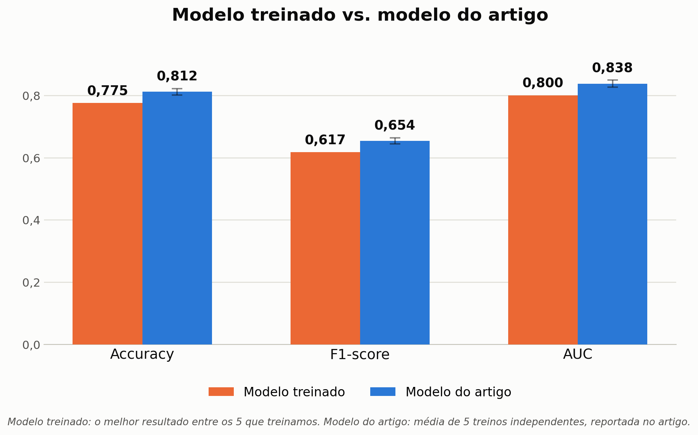
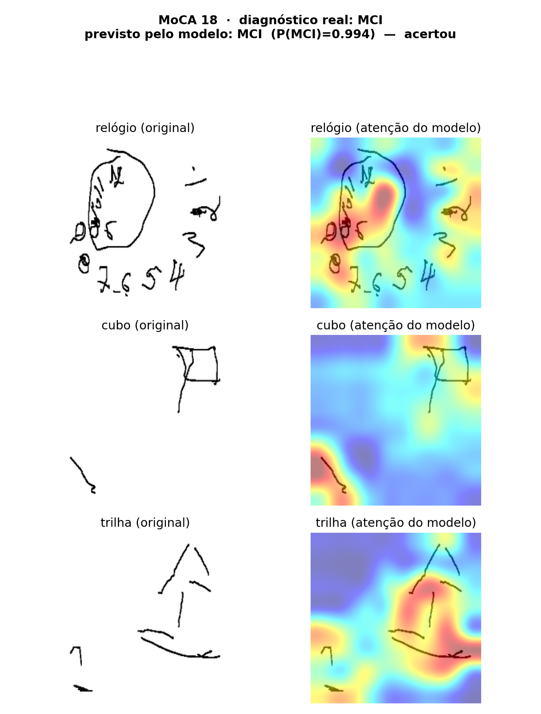
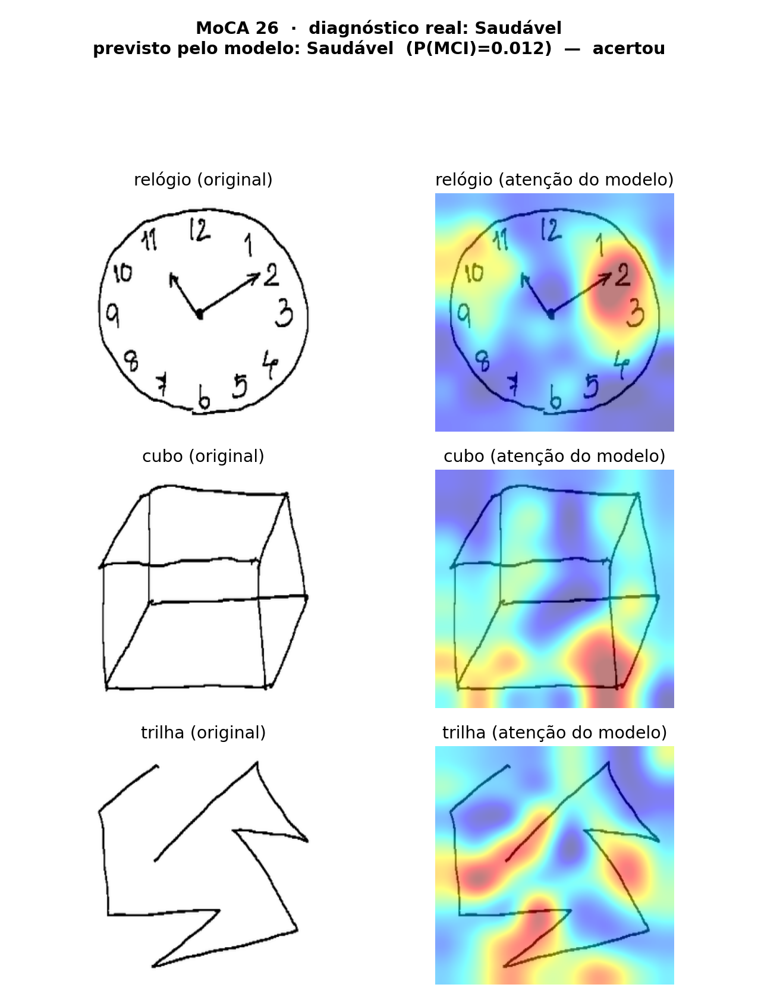

# Modelo de IA — Experimentos e Resultados

Esta página registra os experimentos conduzidos no repositório de IA para a issue "Treinar o modelo base de pontuação": a reprodução do modelo proposto em [Ruengchaijatuporn et al., 2021](https://www.biorxiv.org/content/10.1101/2021.12.15.472738v1.full.pdf) (multi-input Conv-Att com self-attention, para detecção de MCI a partir de desenhos de relógio, cubo e trilha) e a avaliação de uma troca de backbone sugerida pelo professor orientador. Alimenta as funcionalidades "Rodar inferência do modelo embarcado" e "Escore por tarefa e escore geral" descritas em [Funcionalidades](funcionalidades.md).

## Dataset

- **918 sujeitos** · 267 com MCI / 651 saudáveis (classificação pelo escore MoCA, corte em 25)
- **2.754 imagens** (3 desenhos por sujeito — relógio, cubo e trilha — em 256×256px)
- Split estratificado 70/15/15, repetido em 5 seeds aleatórias — a composição do conjunto de teste (138 sujeitos: 98 saudáveis, 40 MCI) bate exatamente com a reportada no artigo em todas as 5 seeds

## Resultado principal

| Modelo | Accuracy | F1-score | AUC |
|---|---|---|---|
| Artigo (Tabela 1, proposto) | 0,812 ± 0,010 | 0,654 ± 0,010 | 0,838 ± 0,012 |
| **Reprodução fiel (VGG16)** | 0,754 ± 0,021 | 0,524 ± 0,057 | 0,765 ± 0,037 |
| **ConvNeXt V2 Tiny** (sugestão do professor) | 0,759 ± 0,020 | 0,531 ± 0,059 | 0,738 ± 0,045 |

Médias e desvios-padrão sobre as 5 seeds. Nenhuma das duas configurações treinadas chega aos números do artigo.

## Diagnóstico (reprodução VGG16)

Antes de aceitar o resultado abaixo do artigo, descartamos bug: zero erro/NaN nos 1.000 blocos de época logados (10 rodadas × 100 épocas), zero sobreposição de sujeito entre treino/validação/teste, e o split de teste bate exatamente com o artigo em todas as seeds.

**Achado central**: nas 10 rodadas treinadas (incluindo uma tentativa de melhoria com balanceamento de classe e seleção por melhor época, que saiu pior, não melhor), o AUC de validação atinge o pico nas primeiras ~20 das 100 épocas e depois estagna ou piora, mesmo com o erro de treino continuando a cair — overfitting. Hipótese principal: as 3 VGG16 são ajustadas por completo (fine-tuning, ~46M parâmetros) usando só 642 imagens de treino por split — capacidade grande demais para o tanto de dado.

## Teste do ConvNeXt V2 (20/10/2026)

Por sugestão do professor, testamos trocar o backbone VGG16 pelo ConvNeXt V2 Tiny (pré-treinado no ImageNet via `timm`), mantendo todo o resto do pipeline idêntico à reprodução fiel — mesmos splits, soft label, otimizador, 100 épocas, 5 seeds — para isolar o efeito da troca de arquitetura.

**Resultado: não houve melhora relevante.** Accuracy e F1 subiram muito pouco (+0,006 e +0,007, dentro do ruído normal entre seeds) e a AUC piorou (0,738 vs. 0,765). Durante o treino, as curvas de validação do ConvNeXt V2 ficaram bem mais estáveis até tarde (sem o colapso cedo da VGG16), mas isso não se traduziu em vantagem no conjunto de teste.

Um ponto de atenção para próximos testes: o ConvNeXt V2 Tiny usado tem **85,7M de parâmetros no total (27,9M por torre)** — mais capacidade que a VGG16 (46,1M no total), não menos. Isso não ataca a hipótese de capacidade-vs-dado; só troca a família da arquitetura.

### Exemplos de inferência (reprodução VGG16, melhor seed)

| Caso MCI (P(MCI) = 0,994, acertou) | Caso saudável (P(MCI) = 0,012, acertou) |
|---|---|
|  |  |

Mapa de atenção (attention rollout) sobreposto ao desenho original, no mesmo estilo da Figura 1 do artigo — mostra onde o modelo concentrou atenção para decidir.

## Próximos passos propostos

- [ ] Testar VGG16 com backbone **congelado** (treinar só a cabeça de atenção) — ataca diretamente a hipótese de capacidade-vs-dado
- [ ] Testar `convnextv2_nano` (~15M de parâmetros por torre, capacidade próxima da VGG16) para uma comparação pareada por capacidade
- [ ] Testar ensemble das 5 seeds (ganho rápido, quase sem custo adicional de treino)
- [ ] Fechar com o parceiro os critérios de "pronto" para o modelo base

## Histórico de Versões

| Versão | Descrição | Autor(es) | Data | Revisor(es) | Data de Revisão |
|---|---|---|---|---|---|
| 1.0 | Criação da página com os resultados da reprodução do artigo (VGG16) e do teste de troca de backbone para ConvNeXt V2 | [Thales Germano Vargas Lima](https://github.com/thalesgvl) | 20/10/2026 | | |
